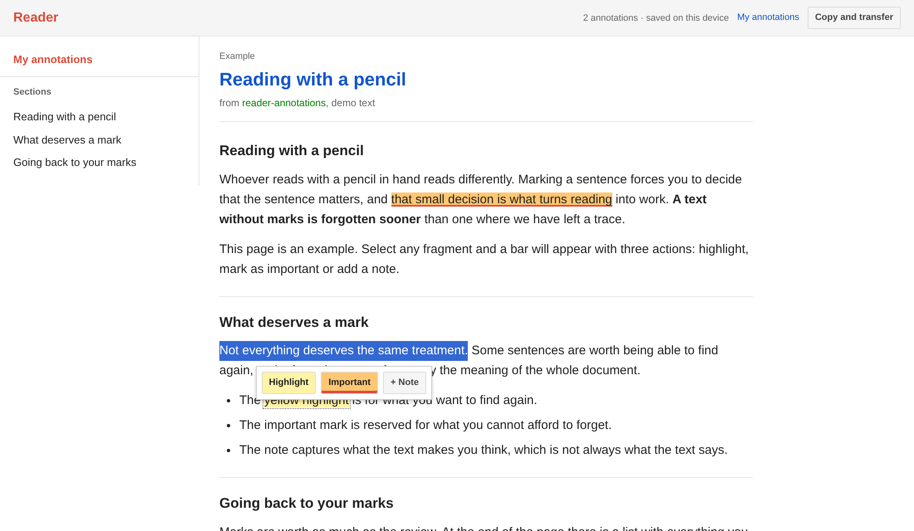

# reader-annotations

Turns any text or document into an HTML page you can read with a pencil in hand: highlight, flag what matters and leave notes. The look is the Google Reader of 2011 to 2013, the same as [reader.torresburriel.es](https://reader.torresburriel.es).

## What it does

- Selecting text shows a bar with three actions: highlight in yellow, mark as important and add a note.
- Tapping a mark lets you change its type, annotate it or delete it.
- A list gathers everything you have marked, with filters and a button that takes you back to the exact spot in the text.
- It includes a free-form notepad.
- Everything is saved in the browser, with no accounts or servers. A copy and transfer dialog lets you move your annotations to another device by copying and pasting.

## Install

1. Download [reader-annotations.zip](https://github.com/torresburriel/claude-skills/raw/main/dist/reader-annotations.zip). Do not unzip it.
2. In Claude, go to Customize > Skills.
3. Click the add button, choose "Upload a skill" and upload the ZIP.

In Claude Code, copy the `reader-annotations` folder into `~/.claude/skills/`.

## Use

Give Claude a text, a PDF or a page and ask for something like "make an artifact from this article so I can annotate it" or "I want to highlight and take notes on this document".

The interface is in English by default. If your document is in another language, Claude translates the labels to match it.

There is a sample page at [reader-annotations/example/index.html](example/index.html). Download it and open it in your browser to try it without installing anything.

## Limits

- Annotations are personal and local. They are not shared between people and do not sync across devices on their own.
- Clearing your browsing data deletes the annotations.
- Tested in desktop Chromium and on iPhone. Not tested on iPad.
- The skill is a single text file of instructions, with no scripts. You can read all of it before installing, which is good practice with any third-party skill.

## License

[GPL-3.0](../LICENSE).

## Author

Daniel Torres Burriel, [Torresburriel Estudio](https://torresburriel.com). More skills in the [repository index](../README.md).
